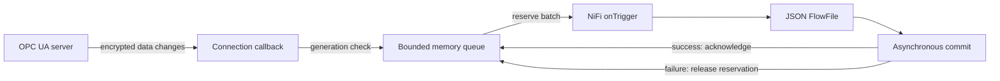

# Architecture

## Modules

| Path | Responsibility |
|---|---|
| `processors/src/main/java` | Shared processor lifecycle, tag parsing, identity loading, JSON and buffering; Java 8-compatible |
| `processors/src/main/milo06` | Milo 0.6 adapter for the legacy build |
| `processors/src/main/milo1` | Milo 1 adapter for the modern build |
| `processors/src/test` | Shared tests and version-specific secure server fixtures |
| `nar` | NiFi extension packaging and generated processor documentation |
| `demo` | Standalone local OPC server; never bundled in the NAR |
| `scripts` | Artifact, publication, formatting and demo utilities |

## Data path

The source accepts no incoming connections and exposes only `success`. Bad-quality data is still data; setup errors are reported through retry/bulletin behavior rather than an error FlowFile relationship.

## Ownership and concurrency

`@OnScheduled` prepares a buffer. `onTrigger` checks cluster ownership before connecting. A lifecycle lock serializes trigger and cleanup; cancellation is signaled before waiting on that lock, so a blocked connection attempt can exit. Role revocation closes the connection. Each attempt fences callbacks so an old connection cannot write into a later generation.

The notification queue is synchronized. It can hold one reserved batch at a time, and overflow never evicts that batch. Commit callbacks capture their original queue, so stop/start and later configuration changes do not acknowledge the wrong records. The old endpoint is held separately from newly configured properties until old data has drained.

Each connection owns a one-thread Netty event loop. Shutdown requests an orderly disconnect, then closes the owned group, including unfinished handshakes. Shared Milo executors are not globally released by an individual processor. Trust-store watchers are closed with their connection. Synchronous modern monitored-item setup uses a guarded cancellation interrupt that is cleared before returning a reusable NiFi worker.

## Boundaries

Local buffering is intentionally in-memory and bounded by record count. There is no replicated state, durable input journal or OPC history reader. A primary switch can overlap with a previously committed batch and a new subscription's initial values; downstream exactly-once behavior is outside this component's contract.
