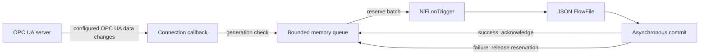

# Architecture

## Modules

| Path | Responsibility |
|---|---|
| `processors/src/main/java` | Shared processor lifecycle, tag parsing, identity loading, JSON and buffering; Java 8-compatible |
| `processors/src/main/milo06` | Milo 0.6 adapter for the legacy build |
| `processors/src/main/milo1` | Milo 1 adapter for the modern build |
| `processors/src/test` | Shared tests and version-specific secure server fixtures |
| `nar` | NiFi extension packaging and generated processor documentation |
| `demo` | Standalone local OPC server; never bundled in the NAR |
| `scripts` | Artifact, publication, formatting and demo utilities |

## Data path

The source accepts no incoming connections and exposes `success` for data and an optional, default-disabled `diagnostics` relationship for health reports. Bad-quality data is still data; setup errors are reported through retry/bulletin behavior rather than an error FlowFile relationship.

## Ownership and concurrency

`@OnScheduled` prepares a buffer. `onTrigger` checks cluster ownership before connecting. Role notifications recheck NiFi's current connected/primary state instead of caching the event, so a delayed revocation cannot disable a re-elected primary. Loss of ownership closes the connection. A lifecycle lock serializes trigger and cleanup; cancellation is signaled before waiting on that lock, so a blocked connection attempt can exit. Each attempt fences callbacks so an old connection cannot write into a later generation.

The notification queue is synchronized. It can hold one reserved batch at a time, and overflow never evicts that batch. Commit callbacks capture their original queue, so stop/start and later configuration changes do not acknowledge the wrong records. The old endpoint and channel security policy/mode are held separately from newly configured properties until old data has drained. `OpcSecurity` shares exact endpoint/token selection across the Milo adapters; client identity and trust-store creation depend on the selected channel and token protection. The version-specific `OpcValue` adapter converts Milo 1 matrices to nested arrays before shared JSON normalization.

Each connection owns a one-thread Netty event loop. Shutdown requests an orderly disconnect, then closes the owned group, including unfinished handshakes. Shared Milo executors are not globally released by an individual processor. Trust-store watchers are closed with their connection. Synchronous modern monitored-item setup uses a guarded cancellation interrupt that is cleared before returning a reusable NiFi worker.

## Boundaries

Local buffering is intentionally in-memory and bounded by record count and serialized bytes. Batches reserve both records and their bytes until commit; their JSON array size also respects the original buffer configuration. There is no replicated state, durable input journal or OPC history reader. A primary switch can overlap with a previously committed batch and a new subscription's initial values; downstream exactly-once behavior is outside this component's contract.

## Session-specific tags and monitoring

`TagAddress` stores the configured numeric or URI address without a live namespace index. `TagResolver` reads the current NamespaceArray, resolves URI addresses, and rejects duplicate numeric targets before monitored-item creation. Each callback captures an immutable resolved tag. A different Milo session triggers a full connection rebuild for URI-configured subscriptions; old callbacks are fenced before new values are accepted. Numeric addresses remain explicit indexes. No address is inferred from a tag alias.

Deadbands use the server's DataChangeFilter with StatusValue trigger. Rejected filters fail setup. The processor does not silently implement a second client-side filter or compensate with historical reads.

`ConnectionDiagnostics` stores bounded metadata and local activity timestamps separately from measurements. Verification owns a temporary connection; normal triggers optionally serialize the current report into a separate FlowFile. Data and health reports produced by a trigger commit together. A pending report suppresses duplicate report scheduling; commit callbacks capture the original report schedule, so an old completion cannot delay reports after Stop/Start. Session callbacks and diagnostics use the same cancellation fence as data callbacks.
